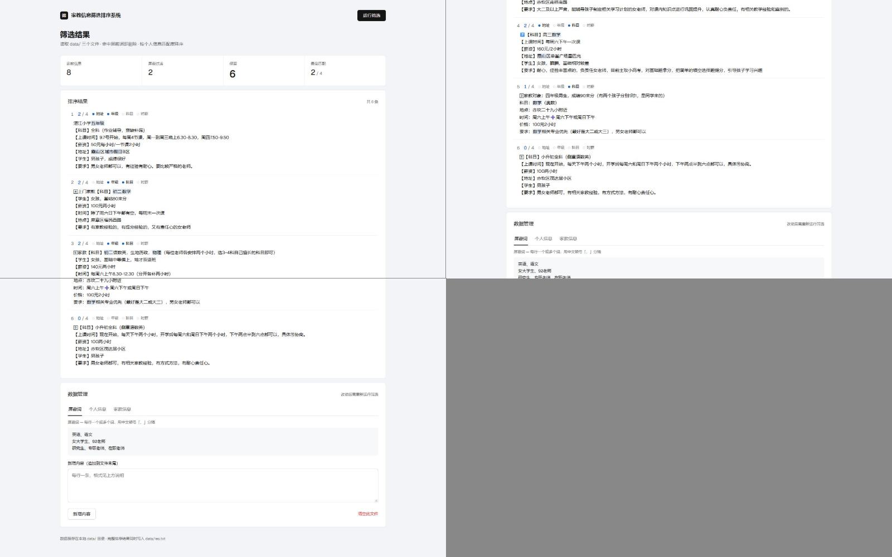
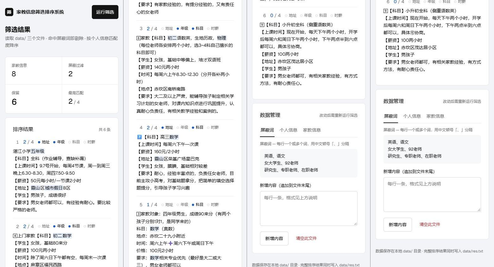

# 家教信息筛选排序系统

一个零依赖的本地小工具：把群里收到的家教信息贴进 `Tutor_info.txt`，系统先用**屏蔽词**剔除不想接的单，再按与**个人信息**的匹配度降序排列，告诉你哪些单子值得先看。结果写入 `res.txt`，也在界面里直接读。

提供命令行、Web 界面、Android 应用三个入口，共用同一套核心流水线。系统行为的完整规格见 [docs/SPEC.md](docs/SPEC.md)，架构图见 [docs/architecture.html](docs/architecture.html)（克隆后用浏览器打开）。

**Web 界面**（桌面端，加载即自动运行筛选；匹配命中的备选词在原文中浅蓝高亮）：



手机端同样可用（指标 2×2、标签页横滑）：



```
命令行 ──────┐
Web 界面 ────┼──▶ 核心流水线（解析 → 过滤 → 计分 → 排序）──▶ res.txt
Android ─────┘            ▲   │
                          │   ▼
                data/ 三个数据文件
```

## 快速开始

要求 Python 3.8+。除 Android 打包外**无任何第三方依赖**。

### Web 界面（推荐）

```bash
python web/server.py        # 默认 8000 端口，可加参数指定端口
```

浏览器打开 <http://127.0.0.1:8000>。页面加载即自动运行一次筛选；改动数据后在右上角重新运行。

### 命令行

```bash
python -m tutorfilter               # 跑流水线，终端预览前 5 条
python -m tutorfilter -n 10         # 预览前 10 条
python -m tutorfilter -d 路径/到/data   # 指定数据目录
```

完整结果始终写入 `data/res.txt`。

### Android

`android/bin/` 下有已构建的 APK，传到手机安装即可。重新构建（需 [Briefcase](https://briefcase.readthedocs.io/)）：

```bash
cd android
briefcase create android && briefcase build android
```

## 数据文件（UTF-8，位于 `data/`）

| 文件 | 格式 |
|------|------|
| `Blocked_words.txt` | 每行一个或多个屏蔽词，`、` 分隔；命中任一词整条剔除 |
| `Personal_info.txt` | 每行 `键：值`（全角冒号）；值是备选词，`、` 分隔 |
| `Tutor_info.txt` | 每条信息一个段落，条与条之间空行 |
| `res.txt` | 输出：按 `===== 第 N 个 =====` 分条的排序结果 |

**匹配度语义**：一个键算匹配，当且仅当它的**任意一个备选词**出现在该条信息里；匹配度 = 命中的键的个数，按其降序排列，同分保持原文顺序。

## Web API

| 方法 | 路径 | 参数 | 说明 |
|------|------|------|------|
| GET | `/api/view` | `?file=文件名` | 查看文件内容 |
| POST | `/api/reset` | `{"file": "文件名"}` | 清空文件 |
| POST | `/api/append` | `{"file": "文件名", "content": "内容"}` | 追加内容 |
| POST | `/api/run` | — | 运行流水线，返回统计与逐条匹配信息 |

文件名白名单：上述四个文件。

## 测试

```bash
python -m unittest discover tests -v     # 21 个用例，纯标准库
```

## 目录结构

```
.
├── tutorfilter/            # 核心包：core.py 纯逻辑 / storage.py 文件读写 / cli.py 命令行
├── web/                    # server.py（标准库 HTTP）+ index.html
├── android/                # Briefcase/Toga 应用（vendored 核心副本，与 core.py 同步维护）
├── tests/                  # unittest 测试
├── data/                   # 数据文件（res.txt 为生成物）
├── docs/                   # SPEC.md（规格）· architecture.html（架构图）
└── pyproject.toml
```

## v2 重建说明

本版本是按「先写规格、测试先行、最小实现」流程的重建版，相对 v1 的行为变化：

- **修复匹配排序失效 bug**：v1 把整条值串（如「五年级、六年级、初一、…」）当子串匹配，几乎永远 0 分；v2 按备选词逐键计分（数据文件无需任何改动）。
- **修复屏蔽词空片段**：行尾多余的 `、` 不再产生能匹配一切的空串。
- **缺文件报错带文件名**，不再返回 `None` 崩在调用方。
- **CLI 精简**为「跑流水线」一件事；文件编辑交给 Web 界面或任意文本编辑器（v1 的编号菜单已移除）。
- 新增 21 个单元测试、规格文档、架构图；Web 界面按工具型应用规范重做。

## License

MIT
